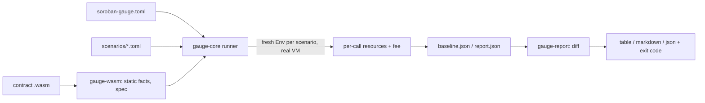

# How it works

1. `gauge-wasm` parses the Wasm with `wasmparser` (never executing it) and decodes the Soroban custom
   sections, so scenario arguments can be typed by the contract's own spec.
2. For each scenario the runner creates a fresh `soroban-sdk` test `Env`, fixes the ledger timestamp and
   sequence number, and **registers each contract from its Wasm bytes**. The host therefore runs the
   compiled contract in the VM. Registering the Rust source natively would skip VM costs and under-report.
3. For each step it converts the arguments, sets the auth mode, invokes the function, and reads
   `cost_estimate().resources()` and `.fee()` immediately. The host resets its metering before each
   top-level invocation, so two calls in one scenario are measured independently; a test compares the first
   call of a scenario with the same call run alone.
4. Results are collected into a baseline: sorted entries, sorted keys, no clocks, no randomness, no hash-map
   ordering, and no paths, so reruns on the same pinned versions produce byte-identical files.
5. `diff` compares two result files with pure functions and renders them; `check` does both steps.
